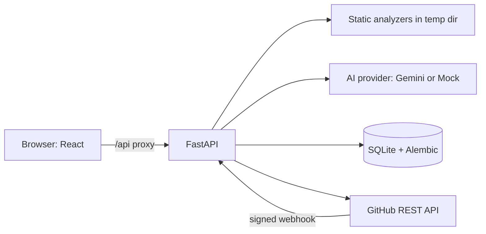

# ReviewAI — AI-Powered Code Review Assistant

ReviewAI reviews source code with an LLM (Google Gemini) **and** deterministic static analyzers, keeps the two clearly separated, stores the results, and can review GitHub pull requests and publish comments only after you explicitly confirm.

## Problem statement and objectives
Manual review misses defects, and LLM-only review can hallucinate issues or line numbers. Objectives: (1) combine AI findings with rule-based analyzer findings, (2) never present unverifiable claims as fact (line numbers are verified against the code, confidence/certainty are shown, mock output is labelled), (3) keep source code private (analyzed, never executed, not stored), (4) fit into GitHub PR workflows without ever acting automatically.

## Features
- **Workspace**: Monaco editor, file upload, language + size validation, original-vs-suggested comparison, copy, Markdown/JSON export.
- **AI review**: Google Gemini (`google-genai` SDK, structured JSON output) via a provider interface; each finding must quote the offending code as *evidence*; strict Pydantic schema; findings carry severity, category, confidence and *certainty* (confirmed vs possible); line numbers are verified against the real code using quoted evidence and dropped if unverifiable; prompt-injection hardening; mock provider clearly labelled.
- **Static analysis**: Python (Ruff, Bandit), JavaScript/TypeScript (ESLint + `eslint-plugin-security`), Java (Checkstyle), C++ (cppcheck). Each analyzer's real status (`ran` / `unavailable: …` / `timeout` / `error: …`) is reported.
- **GitHub**: OAuth connect/disconnect, repositories, branches, open PRs, context-aware review of changed files (surrounding code used as context, findings limited to changed lines), comment selection, explicit confirmation, diff-position validation before publishing, optional signed webhook that triggers reviews (never comments).
- **Dashboard / History**: stats from stored records (severity, category, per-day), search and filters (language, severity, origin), review detail, deletion, retention setting.

## Technology
React 18 + Vite + Tailwind + React Router + Axios + Monaco + Recharts · FastAPI + Pydantic + SQLAlchemy + Alembic (SQLite) · Pytest · Vitest + React Testing Library · Playwright (spec included, see Testing) · GitHub Actions · optional Docker Compose.

## Architecture
See [docs/ARCHITECTURE.md](docs/ARCHITECTURE.md) (Mermaid architecture and ER diagrams).



## Gemini provider status (read first)
The Gemini provider, the `evidence` column (Alembic `0003`), Settings changes and their tests were written in a session with **no network and no installed dependencies**. **Nothing was executed**: no backend or frontend test, lint, build, migration, Ruff or Bandit run, and **no real Gemini call has been made, so this project must not be described as Gemini-powered yet.** Run the verification commands in [docs/TESTING_AND_DEMO.md](docs/TESTING_AND_DEMO.md) and a one-request live check (below) before relying on it.

## Verification status of this archive
The most recent engineering session had **no network access and none of the Python or Node dependencies installed**, so it could not run backend tests, Ruff, Bandit, `pip-audit`, `npm ci`, `npm test`, lint, build, migrations, Playwright, Docker or any Windows check. Only a Python syntax compile of the backend (`python -m compileall`) was executed (it passed). Everything described below as tested comes from earlier sessions and was **not re-verified here**. The frontend still pins Vite 5 / Vitest 2 / `@vitejs/plugin-react` 4 and there is no Python lock file; an earlier report of a Vite 8 upgrade is not reflected in this archive. See [docs/AUDIT.md](docs/AUDIT.md).

## Platform support and verification status
Read this first. **Everything below was developed and verified on Linux only** (Ubuntu 24.04, Python 3.12, Node 22).
- **Windows and macOS have NOT been tested.** No Windows machine was available. What *was* done for Windows: the POSIX-only `resource` import is optional (tested by simulating its absence), analyzers get the Windows system variables they need, executables are located via PATH/`CPPCHECK_PATH`/`JAVA_HOME`/default install folders, subprocess output is decoded as UTF-8, and paths in tests/config use portable forms. `setup.ps1` was executed under **PowerShell 7 on Linux** (not Windows PowerShell, not Windows). A `backend-windows` job in `.github/workflows/ci.yml` will run the backend suite and `setup.ps1` on a real Windows runner — that run, not this README, is the evidence to trust.
- **Not verified against real services:** live Gemini calls, real GitHub OAuth/PR/publish/webhook traffic. Those paths were exercised only against mocks and a local stand-in GitHub server.

## Installation and startup
Prerequisites: Python 3.12+, Node 20+. Optional (for non-Python analysis): a JRE 11+ (Java) and `cppcheck` (C++). Missing analyzers are reported as **unavailable** in Settings and in every review; they are never treated as a clean scan.

**PowerShell** (run from the repository root):
```powershell
cd backend
python -m venv .venv
Set-ExecutionPolicy -Scope Process Bypass      # only if activation is blocked by execution policy
.venv\Scripts\Activate.ps1
pip install -r requirements.txt                # includes Ruff and Bandit (Python analysis)
.\tools\setup.ps1                             # installs ESLint + Checkstyle, checks Java/cppcheck, prints availability
copy ..\.env.example .env                      # edit values; backend/.env is loaded automatically at startup
uvicorn app.main:app --reload                  # http://localhost:8000/docs

# second terminal
cd frontend
npm install
npm run dev                                    # http://localhost:5173  (use localhost, not 127.0.0.1, unless CORS_ORIGINS allows it - the default allows both)
```
`setup.ps1` exits with code 1 and lists what is missing if any analyzer cannot be used (for cppcheck: `choco install cppcheck` or the installer, then set `CPPCHECK_PATH` if it is not on PATH).

**bash** (Linux/macOS):
```bash
cd backend && python -m venv .venv && source .venv/bin/activate
pip install -r requirements.txt && bash tools/setup.sh      # install cppcheck with apt/brew first
cp ../.env.example .env                                      # edit; loaded automatically
uvicorn app.main:app --reload
# second terminal: cd frontend && npm install && npm run dev
```
Real environment variables always override `backend/.env`. The database is created/migrated automatically at startup (Alembic). **Before migrating an existing SQLite database a timestamped backup (`<db>.bak-<UTC time>`) is written next to it.**

Without a Gemini key the app starts in **demo mode**: the AI result is a single `[MOCK]` placeholder and every view labels it. Static analysis still runs for real where the tools are installed.

## Environment variables
All documented in [.env.example](.env.example): `DATABASE_URL`, `CORS_ORIGINS`, `RATE_LIMIT_PER_MIN`, `RETENTION_DAYS`, `GEMINI_API_KEY`, `GEMINI_MODEL`, `GITHUB_CLIENT_ID/SECRET/SCOPE/REDIRECT_URI`, `FRONTEND_URL`, `SESSION_KEY`, `COOKIE_SECURE`, `GITHUB_WEBHOOK_SECRET/TOKEN`.

## Configure Gemini
1. Create a key at <https://aistudio.google.com/apikey>.
2. In `backend/.env` (never committed; copy from `.env.example`) set `GEMINI_API_KEY=...` and optionally `GEMINI_MODEL=...`, then restart the backend. Docker: put them in the root `.env`.
3. Open **Settings**: it shows **Gemini** plus the model, **Mock** (no key; every result is labelled) or **Unavailable** (key set but the SDK/client cannot start, with the reason). The key is read only by the backend and is never returned by any endpoint.

Default model: `gemini-3.1-flash-lite` (stable Gemini 3 model with structured-output support according to Google's published model list at the time of writing). It was **not** confirmed against the live API from this project; model availability changes, so if you see "AI model not found; check GEMINI_MODEL", pick a current model from <https://ai.google.dev/gemini-api/docs/models> and set `GEMINI_MODEL`.

How a review works: the code is sent inside `<code>` tags as untrusted data with a JSON response schema; every finding must quote the offending line (`evidence`); findings without evidence are dropped; line numbers are checked against the real code and removed if they cannot be verified; the result is validated with Pydantic before it is stored. Ruff/Bandit/ESLint/etc. results are produced separately and stored as `static_analysis` findings. Handled failures (each shown as a short message while static results are kept): invalid key, rate limit, quota exhausted, unknown model, timeout (60 s), network failure, blocked prompt, truncated/empty/malformed output. With a key, submitted code is sent to Google.

## Configure GitHub OAuth
1. GitHub → Settings → Developer settings → OAuth Apps → New. Callback URL: `http://localhost:5173/api/github/callback` (must equal `GITHUB_REDIRECT_URI`).
2. Set `GITHUB_CLIENT_ID`, `GITHUB_CLIENT_SECRET`; keep `GITHUB_SCOPE=public_repo` (public repos only, least privilege). Use `repo` only if you need private repos and accept the broader grant; publishing comments needs write access to PRs, which GitHub OAuth Apps grant only through these scopes.
3. Restart, open **Settings → Connect GitHub**. Set a stable `SESSION_KEY` and `COOKIE_SECURE=true` behind HTTPS.

**Webhook (optional)**: add a repo webhook → payload URL `https://<host>/api/github/webhook` (must be publicly reachable; use a tunnel for local testing), content type `application/json`, event *Pull requests*, secret = `GITHUB_WEBHOOK_SECRET`. Set `GITHUB_WEBHOOK_TOKEN` to a read-only fine-grained token so the server can fetch the PR. Webhook reviews are saved (origin "GitHub webhook") and never post comments.

## API
Interactive docs at `/docs`. Main routes: `GET /health`, `GET /capabilities`, `POST /reviews`, `GET /reviews` (filters `q,language,severity,source_kind,limit,offset`), `GET /reviews/{id}`, `GET /reviews/{id}/findings` (`severity,category,source`), `DELETE /reviews/{id}`, `GET /reviews/{id}/report?format=md|json`, `GET /stats`, and under `/github`: `status, login, callback, logout, repos, repos/{o}/{r}/branches|pulls|pulls/{n}/files|pulls/{n}/review|pulls/{n}/publish, webhook`.

## Database
Alembic migrations in `backend/alembic`. Tables: `reviews` (metadata, origin, repo/PR), `findings` (FK → reviews, cascade delete, indexes on review/severity/category), `webhook_deliveries` (dedupe). See ER diagram in [docs/ARCHITECTURE.md](docs/ARCHITECTURE.md). No users table: ReviewAI is a single-user local tool (see limitations).

## Testing
```
cd backend  && python -m pytest -q ; ruff check app tests alembic ; bandit -q -r app ; pip-audit -r requirements.txt
cd frontend && npm run lint ; npm test ; npm run build
cd backend  && python tests/integration/verify_stack.py     # fake GitHub + backend + Vite: OAuth, cookies, CSRF, webhook (needs frontend `npm install`)
cd frontend && npx playwright install chromium && npm run e2e   # browser e2e - NEVER RUN by the author, see below
```
Backend tests are deterministic: by default the Python analyzers are replaced by tiny fakes, so the suite passes whether or not Ruff/Bandit/ESLint/Java/cppcheck are installed; tests that need the real tools are marked `real_analyzers` and **skip with a reason** when a tool is missing. Details and the verification record: [docs/TESTING_AND_DEMO.md](docs/TESTING_AND_DEMO.md).

## Security and privacy
[docs/SECURITY_AND_PRIVACY.md](docs/SECURITY_AND_PRIVACY.md). Summary: code is analyzed in a temp dir and never executed; analyzers get a minimal environment (no secrets) plus timeouts/CPU/file-size limits; source code is never stored; GitHub tokens live only in encrypted server memory behind an HttpOnly cookie with CSRF protection; comments are validated against the diff and require explicit confirmation. **This is not a production-hardened deployment** — see the risk list there.

## Deployment
[docs/DEPLOYMENT.md](docs/DEPLOYMENT.md); `docker-compose.yml` is provided but was **not** built in the authoring environment.

## Known limitations
- **Platforms:** only Linux was tested (see above). On Windows there are no CPU/file-size rlimits for analyzers (only the 30 s wall-clock timeout); on macOS `prlimit` does not exist either.
- **Docker exposure:** `docker-compose.yml` publishes the web UI only on `127.0.0.1:8080`. Do not change this to a public interface while the API is unauthenticated.
- **Single-user:** no accounts or per-user data isolation; anyone who can reach the API can read stored review metadata and spend your Gemini quota. Do not expose it without authentication in front.
- **Rate limiting and GitHub sessions are in-memory** (single process; lost on restart). Behind a reverse proxy the limiter sees the proxy's IP, so all users share one bucket.
- **Real integrations unverified:** Gemini and GitHub (OAuth, PR review, publish, webhook) were exercised only against mocks and a local stand-in server. Real GitHub behaviours not covered include SSO-protected orgs, fine-grained-token quirks and rate limits.
- **Playwright e2e is written but was never executed** (no browser could be installed in the authoring sandbox). The unit tests use a jsdom, not a real browser; the CSRF header is set by an axios interceptor that is unit-tested, and the cookie/redirect flow was verified with an HTTP client through the Vite proxy, not in a browser.
- **Docker files are unbuilt.**
- **Analyzer depth:** Java/C++ analyzers run a small curated rule set on a single file (no project build, no cross-file or type-aware analysis). Static findings are rule matches and may be false positives; AI findings can be wrong. Both are labelled.
- **PR review limits:** up to 20 supported files per PR, files ≤200 KB, ±15 lines of context; PRs with >1000 changed files are truncated by pagination. Findings on unchanged lines are kept as notes and cannot be published as line comments.
- **Webhooks:** every `synchronize` event creates a new review (no coalescing of rapid pushes). A failed run can be retried by redelivering the same event; a successful one is deduplicated. Reviews run in-process in a background task (not durable across restarts).
- **Migrations:** only SQLite is tested. Migration `0002` is not reversible (restore the automatic backup instead). Malformed legacy JSON rows are migrated as reviews with zero findings rather than aborting.
- **`npm audit`** reports advisories; see the security document.

## Future work
Authentication and per-user ownership, persistent encrypted token store / GitHub App, SARIF export, more analyzers (Semgrep, clang-tidy, SpotBugs), background job queue, finding de-duplication across PR pushes.

## Demonstration workflow
1. Start both servers; Settings shows "demo (mock AI)" and analyzer availability.
2. Workspace → Analyze the sample → compare static findings (Bandit B307) with the labelled MOCK notice; switch to Java/C++/JS samples.
3. Add `GEMINI_API_KEY`, restart, re-run: AI findings appear with certainty, confidence and verified line numbers.
4. History/Dashboard: filter, open, export Markdown/JSON, delete.
5. (With OAuth configured) GitHub → pick repo → PR → Review → select comments → tick confirmation → Publish.
