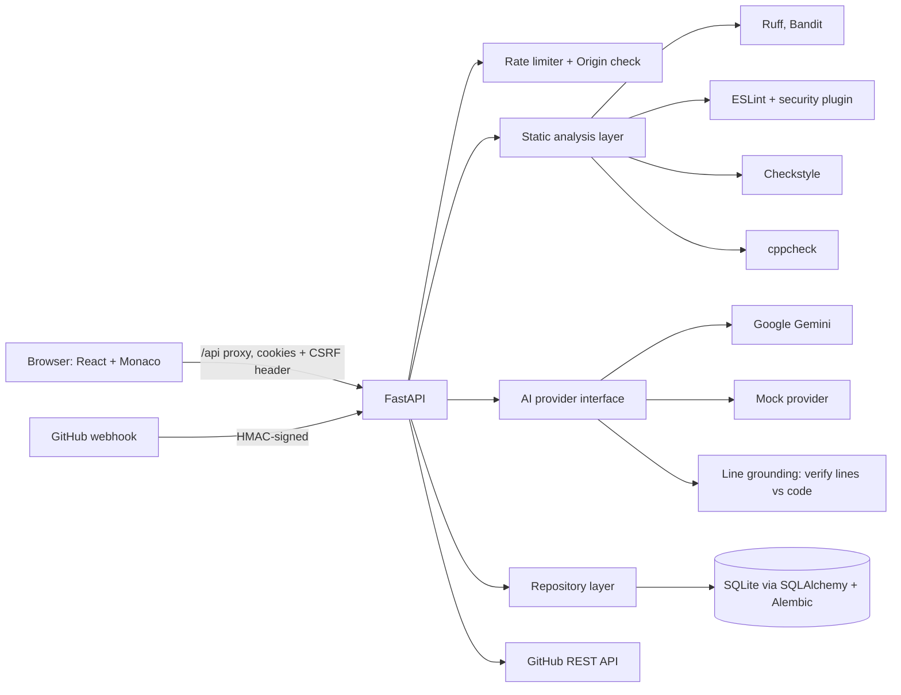
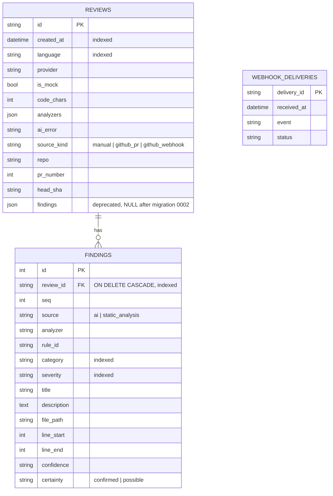

# Architecture

GitHub sessions are not in the database: they are held in server memory (Fernet-encrypted token + CSRF secret), keyed by an HttpOnly cookie.

## Startup
`app/__init__.py` loads `backend/.env` (never overriding real environment variables), then `app/db.py` runs Alembic: fresh DBs get the full schema, pre-Alembic DBs are stamped at `0001` and upgraded, and an existing SQLite file is copied to `<db>.bak-<UTC time>` first. Analyzer availability is computed on demand (PATH, `CPPCHECK_PATH`, `JAVA_HOME`, default Windows install folders) and surfaced via `/capabilities` and each review's `analyzers` map.

## Request flow (workspace review)
1. `POST /reviews`: Pydantic validation (≤100,000 chars, supported language), rate limit, optional retention purge.
2. Static analyzers run on a temporary copy (`shell=False`, minimal env, timeout, CPU and file-size limits); status per analyzer is recorded.
3. Code is sent to the provider with `L<n>:` line prefixes inside `<code>` tags (treated as data). Output is parsed, each finding validated against the Pydantic schema (invalid ones dropped), then **grounded**: claimed lines must exist and the quoted evidence must appear there; otherwise the line is remapped to a unique evidence match or removed and confidence lowered.
4. Findings are stored relationally; source code is not.

## GitHub PR review
For each supported changed file: fetch the full file at the PR head, build a numbered excerpt (changed lines marked `>`, ±15 lines of context), run static analyzers on the full file and keep only findings on changed lines, run the AI review and ground results to changed lines. Publishing re-checks that the PR head is unchanged (409 otherwise) and that every comment's `(path, line)` exists on the RIGHT side of the diff (422 otherwise), neutralises `@mentions`, and posts a single review with `event=COMMENT`.

## Methodology note
AI and analyzer findings are never merged into one "truth": each finding states its source, analyzer/rule, confidence and certainty so a reader can weigh it.
